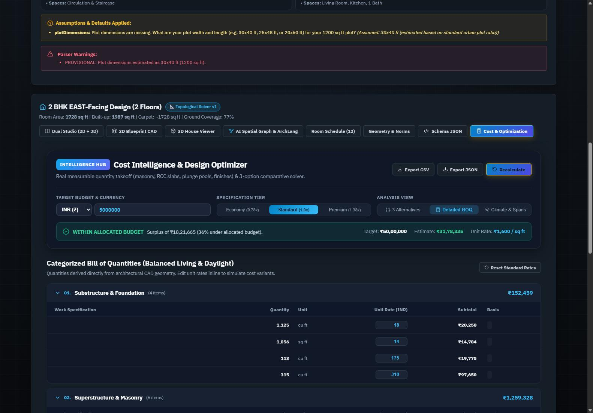
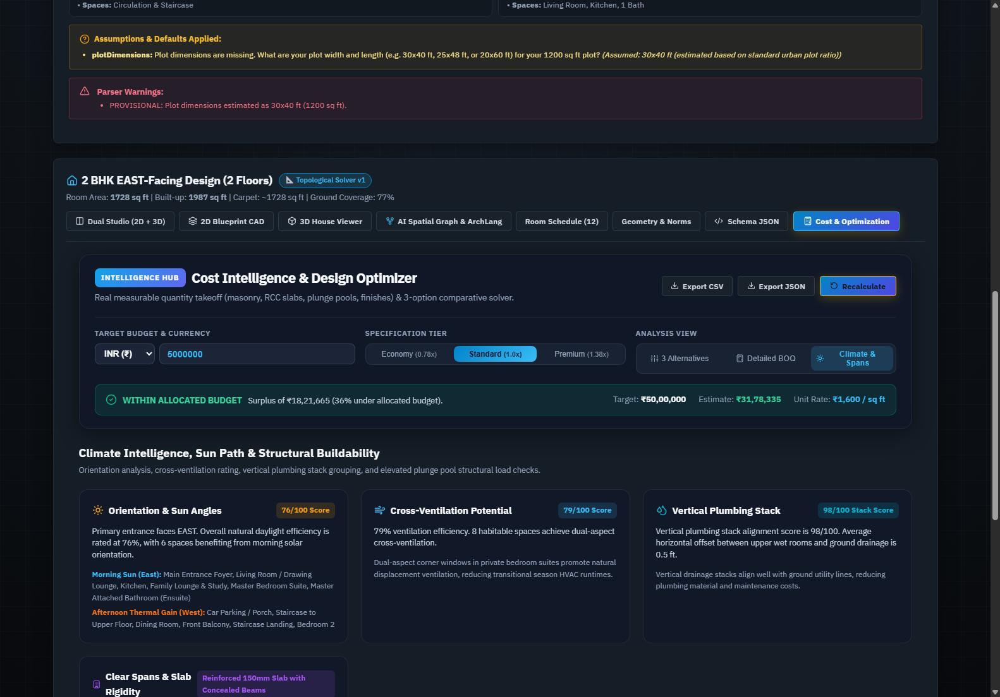
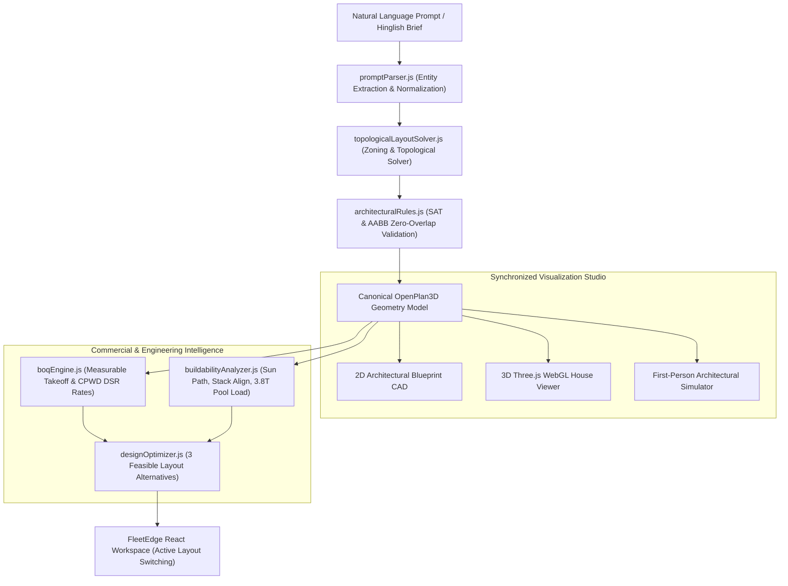

# ArchAI 🏛️✨
> **AI-Powered Architectural Intelligence & Generative CAD Platform**

ArchAI is an end-to-end architectural intelligence system that translates natural-language residential requirements (in English or conversational Hinglish) into code-compliant **2D CAD blueprints**, interactive **3D Three.js models** with an exploded multi-floor slider, **first-person walkthrough exploration**, measurable **Bill of Quantities (BOQ)**, budget-aware **multi-option design optimization**, and preliminary **climate and structural buildability analysis**.

ArchAI does not generate flat, unmeasurable pictures. **It computes architecture.**

---

## 🌟 Key Capabilities

### 1. 🗣️ Conversational & Hinglish Natural Language Ingestion
- Extracts intent, room counts, orientations, and custom requirements from formal English or casual Hinglish prompts:
  - *Example*: `"Mujhe 1200 sq ft me 2 floor ka makan chahiye ground floor pe gaadi parking aur 1st floor pe 2 BHK purab mukhi"`
  - *Example*: `"Plot: 30 x 40 ft, east facing. Ground floor: one car parking space, staircase, usable enclosed under-stair storage, and a separate enclosed room containing an actual small plunge pool. First floor: exactly two bedrooms, one balcony, and a separate enclosed room containing its own actual small plunge pool."`
- Universal unit normalizer (`sq yards`, `gaj`, `sq meters`, `feet`).
- Disambiguates aquatic plunge pools from recreational billiards tables.
- Transparently distinguishes extracted facts from provisional assumptions and generates clarification questions.

### 2. 📐 Constraint-Aware Topological Layout Solver
- Uses topological adjacency graphs and functional spatial zoning (Public, Private, Service, Circulation, Outdoor).
- Enforces municipal setbacks (front, rear, side) leaving a legal, buildable envelope.
- **Vertical Staircase Stacking**: Ground floor and first floor staircase shafts match identical $(x, y, w, l)$ coordinates.
- **Ensuite Bathrooms**: Guarantees shared boundary walls with master suites and private access doors.
- **Infeasibility Detection**: Mathematically verifies if requested program exceeds plot capacity and rejects impossible requests with explicit deficit metrics.

### 3. 🛡️ Geometric Verification & Zero Overlaps
- Statutory compliance engine using **Separating Axis Theorem (SAT)** and **2D AABB collision detection**.
- **Mathematically guaranteed 0 geometric room overlaps** on every level.
- Mandatory room inventory preservation: explicitly requested rooms (parking, under-stair storage, plunge pools) are never dropped.

### 4. 🎮 Dual Synchronized Studio & 3D Three.js WebGL Engine
- **2D Blueprint CAD Editor**: Millimeter-precise scale, wall thicknesses, door swings, window cutouts, collision snapping ($0.5\text{ ft} / 1.0\text{ ft}$), and undo/redo history.
- **3D House Viewer**: Procedural Three.js geometry with real wall thickness, glass windows, stepped stairs, animated water-shader plunge pools, and contextual 3D furniture.
- **Exploded Multi-Floor Slider**: Vertically elevates upper floors on an accordion slider to inspect ground and first floor layouts simultaneously.
- **First-Person Walkthrough Simulator**: WASD + mouse camera controls with smooth wall-sliding collision detection, automatic step-up allowance, door opening interactions (`[E]`), and light toggles (`[F]`).

### 5. 💰 Measurable BOQ & Quantity Takeoff Engine
- Computes an itemized 10-category Bill of Quantities using measurable quantities extracted directly from CAD geometry:
  - **Net Masonry**: Gross wall surface area minus door and window openings.
  - **Concrete Volumes**: RCC M25 pad footings, columns, and $125\text{mm}$ suspended floor/terrace slabs.
  - **Flooring Finishes by Room**: Double-charged vitrified tiles, anti-skid bathroom tiles, heavy-duty parking pavers, glass mosaic plunge pool tiles.
  - **MEP Points**: CPVC supply, $110\text{mm}$ SWR drainage pipes, sanitary suites, light and 16A power points.
  - **Plunge Pool MEP**: Sunken RCC basin shell, crystalline waterproofing, mosaic tiling, filtration pump equipment.
  - **Indirect Works**: Contractor overheads ($10\%$), contingency ($3\%$), and statutory tax/GST ($18\%$).
- Multi-Currency (INR ₹, USD $, EUR €, GBP £, AED) and Quality Tiers (Economy $0.78\times$, Standard $1.0\times$, Premium $1.38\times$).
- Inline editable unit rates with real-time recalculation, CSV spreadsheet export, and detailed JSON export.

### 6. ⚖️ Budget-Aware Multi-Option Design Optimization
- Automatically synthesizes and compares **3 distinct layout alternatives** for the same plot and prompt:
  1. **Option A: Value-Engineered (Lowest Cost)**: Aligns vertical plumbing stacks, standardizes spans, reduces custom lintel cutting.
  2. **Option B: Space Maximizer (Highest Carpet Area)**: Trims circulation corridors to deliver maximum usable bedroom and living lounge carpet area ($87\%$ carpet efficiency).
  3. **Option C: Balanced Living & Daylight (Recommended)**: Optimal balance of natural daylight, cross-ventilation, and functional flow.
- **100% Mandatory Room Preservation**: Every alternative strictly satisfies all requested rooms.
- **One-Click Active Switching**: Clicking *"Switch Active Design to This Option"* dynamically updates the active design in the 2D CAD blueprint, 3D viewer, and walkthrough in real time.

### 7. ☀️ Climate Intelligence & Structural Buildability Analyzer
- **Orientation & Daylighting**: Identifies East morning sun access ($76/100$) vs West afternoon thermal shielding.
- **Cross-Ventilation**: Evaluates dual-aspect exterior wall exposures across all habitable rooms.
- **Vertical Plumbing Stack Alignment**: Computes horizontal distance between upper-floor wet areas and ground drainage lines ($98/100$ alignment score with $0.5\text{ ft}$ offset).
- **Elevated Plunge Pool Structural Advisory**: Calculates water mass live load ($\approx 3.8\text{ metric tons}$) $+$ concrete basin dead load ($\approx 5.5\text{ metric tons}$ total load, $\approx 260\text{ lbs/sq ft}$ vs standard residential $40\text{ lbs/sq ft}$), mandating a $200\text{mm}$ sunken drop panel, direct column load transfer to footings, and dual-layer crystalline waterproofing with a 72-hour flood test.

---

## 📸 Screenshots

| 3-Option Design Alternatives | Detailed Interactive BOQ Table | Climate & Buildability Studio |
| :---: | :---: | :---: |
|  |  |  |

---

## 🏗️ System Architecture



---

## 🧪 Automated Test Suite (122 / 122 Tests Passing)

The entire pipeline is verified by **122 automated unit and integration tests**:

```bash
# Run backend test suite
cd server
npm test
```

Test coverage includes:
- `cost_optimizer.test.js`: BOQ quantity takeoff, multi-currency scaling, 3 layout alternatives, elevated plunge pool water load math ($\approx 3.8\text{T}$).
- `topological_solver.test.js`: Kitchen placement, ensuite bath adjacency, entrance orientation, stair stacking, zero overlaps, infeasibility rejection.
- `phase3_canvas.test.js`: 2D coordinate conversion, snapping, dragging, boundary clamping.
- `phase4_3d.test.js`: Three.js procedural wall extrusions, door cutouts, staircase steps, furniture placement.
- `phase6_simulator.test.js`: FPS movement, wall sliding, auto step-up, door interaction (`[E]`), lighting (`[F]`).
- `teammate_backend_spec.test.js`: Hinglish parsing, unit conversion, 7 design modification operations, RESTful endpoints.

---

## 🚀 Quick Start Guide

### Prerequisites
- Node.js (v18 or higher)
- npm or yarn

### 1. Clone the Repository
```bash
git clone https://github.com/avantikarathi01/archai.git
cd archai
```

### 2. Backend Setup
```bash
cd server
npm install
npm start
# Server runs on http://localhost:5000
```

### 3. Frontend Setup
```bash
cd ../client
npm install
npm run dev
# Vite client runs on http://localhost:5173
```

---

## 🛠️ Tech Stack

- **Frontend**: React 18, Vite, Three.js, GSAP Animations, Lucide Icons
- **Backend**: Node.js, Express, ES Modules
- **Geometry & Math**: Computational 2D AABB, Separating Axis Theorem (SAT), Spatial Adjacency Graphs
- **Cost & Estimating**: Indian CPWD DSR 2024 Schedule Mapping, Real Geometry Takeoff
- **Tests**: Native Node.js Test Runner (`node:test`, `node:assert`)

---

## ⚖️ Legal & Engineering Disclaimer

Calculations, bill of quantities, structural load approximations, and climate orientations are preliminary engineering heuristics for concept design and optimization. They do not substitute for stamped working drawings or tender documents from a certified civil/structural engineer, quantity surveyor (QS), or licensed architect.
